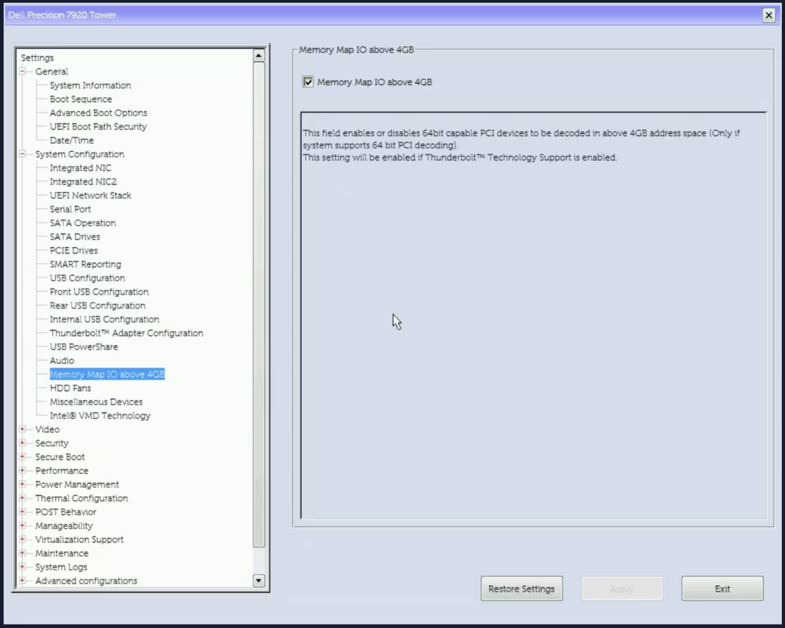
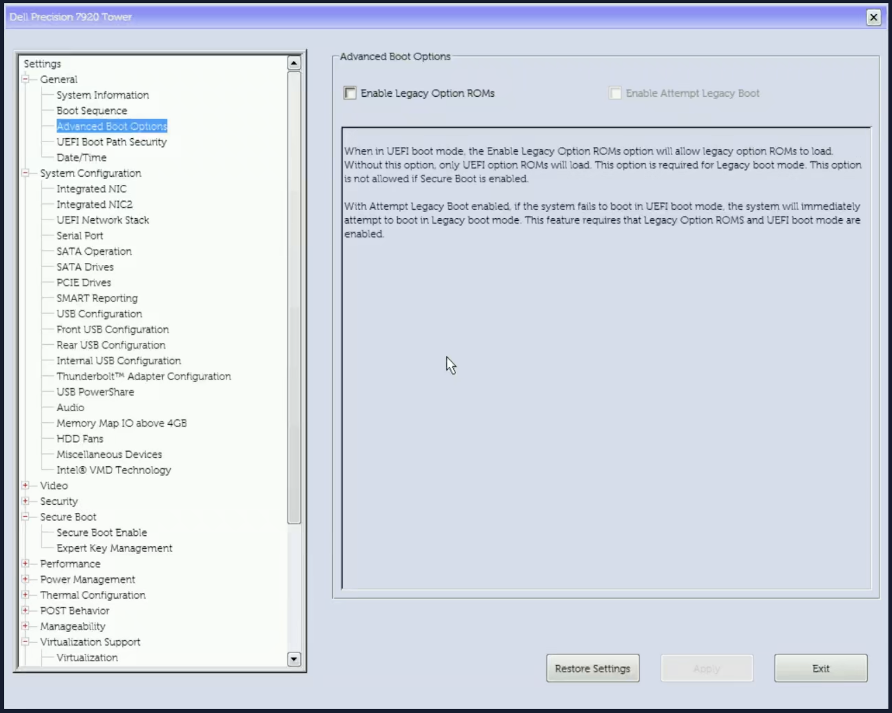

# Dell Precision 7920 Tower: 32GiB GPU BAR on Proxmox

[简体中文](README.zh-CN.md)

Reference configuration: **BIOS 2.52.2**, Radeon AI PRO R9700, PVE kernel 7.0.14-26-pve and QEMU 11.0.3, with **32GiB BAR0** on host and guest. Other BIOS versions require fresh firmware review. BAR size alone does not establish an inference speedup.

> [!CAUTION]
> **This is a worked example, not a copy-paste recipe.** The `0 → 3` value, the `0x04` offset, the `3` enum, the 32GiB target and the 256MiB starting BAR are specific to this BIOS/GPU. The Python tools are generic, but the generated `REBAR-PLAN`, the manual `setup_var` command and the private profile are not. Do not reuse them on another BIOS or machine; writing the wrong field can make the machine unbootable. Re-audit and re-extract the IFR for your exact firmware first. Use [Adapting to another GPU or BIOS](#adapting-to-another-gpu-or-bios) for other hardware.

**Terms:** BAR = PCI Base Address Register; BAR0 is the GPU's main MMIO aperture. The root window is the high-MMIO range the BAR must fit in; every upstream bridge must cover it. VFIO/IOMMU are the passthrough prerequisites. `resource0_resize` is the Linux sysfs interface used to request a new BAR size. PVE = Proxmox VE; ESP = EFI System Partition.

**Host:** Linux with sysfs/efivarfs, `sudo`, Python 3.10+, `pciutils`, `util-linux`, `dosfstools`, `parted`, `initramfs-tools` (for `lsinitramfs`), and network access for the pinned USB tools. Use a separate USB stick; no repository script formats disks.

## How it works (summary)

### Two layers of change

This is not a BIOS flash. It is equivalent to changing one hidden BIOS setting without the Dell UI, plus a Linux-side runtime resize:

| Layer | What changes | Where it lives | When | Persistent? |
|---|---|---|---|---|
| Firmware | `SocketCommonRcConfig`: MMIO High Granularity `0 → 3` | UEFI variable in SPI NVRAM | once, from UEFI Shell (`setup_var.efi`) | yes, across reboots |
| Linux | GPU BAR0 `256MiB → 32GiB` | PCIe runtime configuration | every boot (`rebar_resize.py` / service) | no, reset by reboot |

```text
[SPI flash]
├─ BIOS code/image          unchanged
└─ UEFI variable store
   └─ SocketCommonRcConfig: [Granularity = 3]   ← one-time write
            │ next boot
            ▼
   firmware high-MMIO root window = 64GiB
            │ Linux boot
            ▼
   resource0_resize: BAR0 = 32GiB               ← every boot
```

The firmware must provide a large enough root window before Linux can place a 32GiB BAR: the variable makes it allocate 64GiB, and Linux resizes the BAR inside that window. The 64GiB window is CPU address space, not RAM. `ROLLBACK.nsh` sets the variable back to `0`, equivalent to restoring the BIOS setting; disabling the service removes the Linux-side resize. This does not modify the BIOS image, CMOS, the ESP/boot disk, the kernel binary, or the GPU VBIOS.

**The procedure in four steps:**

1. UEFI boot, Above 4GB decoding and adequate high MMIO space.
2. On this exact BIOS, change **only MMIO High Granularity** from enum `0` to `3`, providing a 64GiB root window. Keep MMIO High Base unchanged.
3. Before starting the GPU VM, unbind its idle VFIO functions, request **BAR0 exponent `15`** (32GiB here) through Linux `resource0_resize`, verify allocation, then rebind VFIO.
4. Run the checked resize before `pve-guests.service` on subsequent boots.

Follow the full procedure below, including the backup and verification gates. PCIe bus allocation, VMD and USB settings are not BAR-size controls.

## Adapting to another GPU or BIOS

The commands are parameterized; the 2.52.2/R9700 values are examples.

1. **Choose the target BAR size.** Read the GPU's `resource0_resize` supported mask (or `lspci -vv`) and pass `--target-gib N` to the audit; use the same value for the before/after baselines and the profile. It must be a power of two; the default is 32.
2. **Choose the smallest high-MMIO window that contains it.** Read the MMIO High Granularity enum from the exact IFR. A 16GiB option cannot contain a 32GiB BAR; 64GiB is the first fit here. Keep MMIO High Base unchanged unless the exact IFR and address-limit check show that the existing Base cannot cover the target.
3. **Check the address limit.** Require `Base + maximum window <= 2^physical_address_bits`; the audit reports `physical_address_bits`.
4. **Use the same guarded flow.** Do not reuse the 2.52.2 offset (`0x04`) or enum (`3`) unless your IFR matches. Set the observed starting BAR0 with `--initial-bar0-mib M` (256 here); the default is also 256, so always check it for other GPUs.

## Start here

Use a local Linux console or your own SSH connection. Commands below run **on the host**. Set `USB` and `TARGET_GIB` as shown; store raw reports privately and recovery backups on USB, following the [data policy](docs/PRIVACY.md). Python 3.10+; standard library only. Read-only checks may need root.

```sh
USB=/mnt/rebar-usb          # example; use your actual USB mount point
TARGET_GIB=32               # example; use your GPU's supported target
sudo python3 -B scripts/rebar_audit.py --target-gib "$TARGET_GIB" --private-output "$USB/before.json"
# Exit 2 means review needed; a small root window is an expected initial finding.
```

The report on stdout omits instance identifiers. The opt-in JSON contains device identities, topology and resource addresses: keep it private. More than one candidate GPU requires explicit local selection with `--gpu`.

| Order | Action | Checkpoint |
|---|---|---|
| 1 | [Audit firmware and hardware](docs/FIRMWARE.md) | Exact BIOS image/IFR, live variable and CPU address limit agree |
| 2 | [Prepare recovery USB and backups](docs/USB.md) | Hashes, decompression and offline recovery-file checks pass |
| 3 | Boot USB (F12 → UEFI USB → Shell; see [USB](docs/USB.md)); run read-only CHECK, then PVE rescue | Original PVE/ZFS boots using USB loader/kernel/initrd |
| 4 | Boot USB again (same USB; see [USB](docs/USB.md)); guarded round trip, then APPLY | Complete original restored during test; only reviewed field changes on apply |
| 5 | Boot PVE; check variable and root window; resize idle GPU | Host BAR0 reaches the target and every upstream bridge covers it (32GiB here) |
| 6 | Test one GPU VM, then install boot service (commands in [Firmware](docs/FIRMWARE.md)) | Guest BAR, AMDGPU, ROCm/HIP pass; shut down VM normally |
| 7 | Normal host reboot and final check | Boot service starts from the firmware-default BAR and produces the target before PVE guests (256MiB → 32GiB here) |

**Typical plan: 2 USB Shell boots + 3 PVE boots** (rescue, modified PVE, final reboot), plus an optional cold recovery-menu test. Record F2 settings in one visit; exiting F2 may add a reboot. Do not combine APPLY with an untested rescue path just to save a reboot. [Validation checkpoints](docs/VALIDATION.md).

> [!WARNING]
> **Stop and review** on ambiguous GPU/variable identity, a BIOS/IFR mismatch, an unexpected full-variable diff, an active VM/VFIO holder, or insufficient root-window/bridge coverage. Never delete guard files or reuse an old plan to force a pass.

## BIOS settings that matter





Use UEFI, enable **Above 4GB** (BIOS label: **Memory Map IO above 4GB**) and disable **Legacy Option ROMs** (BIOS label: **Enable Legacy Option ROMs**). Enable **VT-d** (BIOS label: **VT for Direct I/O**) for passthrough. Disabling Secure Boot is for the unsigned Shell/setup_var tools (and any unsigned rescue kernel); it is not part of the BAR change. Restore your normal policy after the Shell work if your boot chain supports it. Preserve working storage/boot settings. [BIOS reference screens](docs/SCREENSHOTS.md).

## Repeat after a BIOS update or GPU move

```sh
sudo python3 -B scripts/rebar_audit.py --target-gib "$TARGET_GIB" \
  --baseline "$USB/before.json" --private-output "$USB/after.json"
```

The script compares the current BIOS/build, GPU identity, topology, IOMMU and BAR support; **it never approves a new BIOS offset**. Use the same `TARGET_GIB` as the original baseline; the resize tool rejects a changed target. Re-extract and cross-check IFR before generating another plan; a BIOS update also invalidates the old profile/plan. A moved GPU requires reviewing the Proxmox PCI mapping and replacing the runtime profile.

## Reusable tools

| Script | Default behavior |
|---|---|
| `rebar_audit.py` | Read-only discovery; `--target-gib` sets the target (default 32GiB); redacted stdout, optional private JSON |
| `ifr_review.py` | Parse IFR text; `--pe32` independently checks raw opcode widths/offsets/options |
| `make_profile.py` | Create a private profile only after explicit exact-version review confirmation; `--initial-bar0-mib` records the observed starting BAR0 |
| `uefi_plan.py` | Generate guarded CHECK / ROUNDTRIP / APPLY / ROLLBACK; never writes firmware itself |
| `rebar_resize.py` | Check only; `--execute` required for idle VFIO unbind/resize/rebind |
| `guest_check.py` | Run inside the guest; waits for AMDGPU, checks BAR/VRAM/ROCm; optional `--hip-test` |
| `prepare_usb.py` | Populate an **empty, already formatted** USB; downloads pinned tools; never formats disks |
| `esp_backup.py` | USB-only backup/verify; restore additionally requires exact target PARTUUID |
| `usb_archive.py` | Explicit recovery-file selection; single ZIP when it fits FAT32, otherwise ≤2GiB parts; verified USB reconstruction |
| `recovery_manifest.py` | Select boot/tools/actual backups, exclude screenshots and test-image copies |
| `privacy_check.py` | Text/PNG metadata checks; optional private screenshot hash allowlist |

Generate profiles from the current machine and validate manual resizing before enabling automation. Use only one resize service; review any existing implementation before replacing it.

## Rollback and BIOS upgrades

**Before a BIOS upgrade:** disable the resize service, run the matching `ROLLBACK.nsh`, and verify the original variable. Keep normal SATA/UEFI/VT-d settings recorded; a full BIOS reset is not required solely for this workaround. After updating, keep automation disabled until a fresh IFR review passes. [Rollback and upgrade details](docs/RECOVERY.md).

Keep raw logs/screenshots and local profiles in your own private repository; keep recovery images and the complete USB package offline on USB/NAS. Credentials belong in neither Git repository. [Privacy boundaries](docs/PRIVACY.md).

## Agent prompt, tests and references

[Reusable agent prompt](prompt.md) · [Safety tests](tests/test_safety.py)

```sh
python3 -B -m unittest discover -s tests -v
python3 -B scripts/privacy_check.py .
# Optional: add --denylist/--image-allowlist from your private policy files.
```

[Original V100 discussion](https://github.com/xCuri0/ReBarUEFI/discussions/331) · [Linux 7.0 resize implementation](https://github.com/torvalds/linux/blob/v7.0/drivers/pci/pci-sysfs.c) · [QEMU 11.0.3 VFIO](https://github.com/qemu/qemu/blob/v11.0.3/hw/vfio/pci.c) · [Dell recovery](https://www.dell.com/support/kbdoc/en-us/000132453/how-to-recover-the-bios-on-a-dell-computer-or-tablet)
