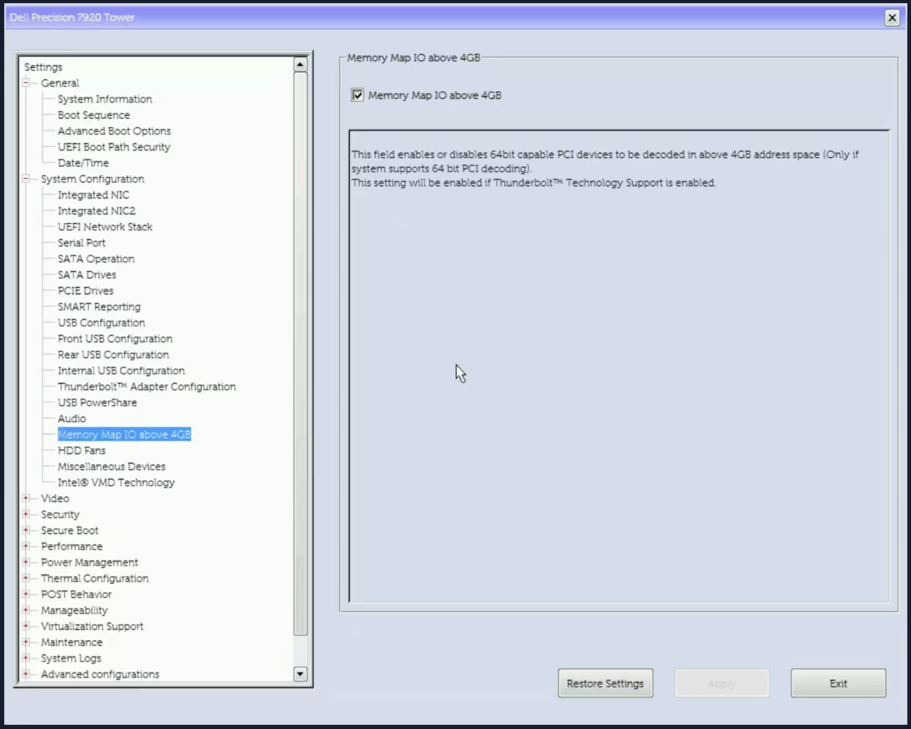
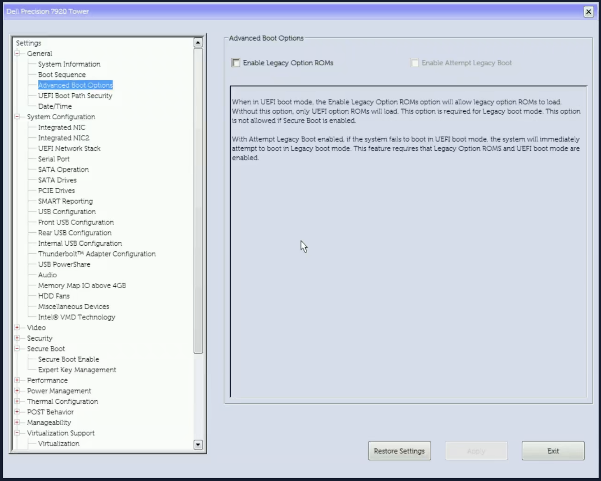

# Dell Precision 7920 Tower：在 Proxmox 使用 32GiB GPU BAR

[English](README.md)

参考配置：**BIOS 2.52.2**、Radeon AI PRO R9700、PVE内核7.0.14-26-pve、QEMU11.0.3，主客机使用**32GiB BAR0**。其他BIOS版本必须重新审核固件；BAR变大本身不证明推理性能提升。

> [!CAUTION]
> **这是案例，不是可以直接复制的配方。** `0 → 3`、`0x04` 偏移、`3` 枚举、32GiB 目标和 256MiB 初始 BAR 都只适用于本文的 BIOS/GPU。Python 工具是通用的，但生成的操作单、手动 `setup_var` 命令和私有配置不能直接套到另一台机器或另一个 BIOS 版本；写错字段可能让机器无法启动。请先对你的准确固件重新审计并提取 IFR。其他硬件请按下文“适配其他 GPU 或 BIOS”重新推导。

**术语：**BAR = PCI 基址寄存器（Base Address Register），BAR0 是 GPU 的主要 MMIO 窗口；根窗口是高位的 MMIO 地址范围，BAR 必须能放进去，且每一级上游桥都要覆盖它；VFIO/IOMMU 是直通前提；`resource0_resize` 是 Linux sysfs 中请求新 BAR 大小的接口；PVE = Proxmox VE；ESP = EFI 系统分区。

**主机要求：**Linux（sysfs/efivarfs）、`sudo`、Python 3.10+、`pciutils`、`util-linux`、`dosfstools`、`parted`、`initramfs-tools`（提供 `lsinitramfs`），以及能联网下载固定版本 USB 工具。另需一只独立 U盘；仓库脚本不会格式化磁盘。

## 实现要点（摘要）

### 两层改动

这不是刷 BIOS，而是等同于改一个隐藏的 BIOS 设置（只是不走 Dell UI），再加 Linux 侧的运行时调整：

| 层 | 改什么 | 存在哪里 | 何时 | 是否持久 |
|---|---|---|---|---|
| 固件层 | `SocketCommonRcConfig` 的 MMIO High Granularity `0 → 3` | SPI flash 里的 UEFI 变量（NVRAM） | UEFI Shell 里执行一次 `setup_var.efi` | 是，重启仍在 |
| Linux 层 | GPU BAR0 `256MiB → 32GiB` | PCIe 运行时配置 | 每次开机由 `rebar_resize.py` / 服务执行 | 否，重启回到 256MiB |

```text
[主板 SPI flash]
├─ BIOS 代码/镜像             不改
└─ UEFI 变量存储区
   └─ SocketCommonRcConfig: [Granularity = 3]   ← 一次性写入
            │ 下次开机
            ▼
   固件分配的高位 MMIO 根窗口 = 64GiB
            │ Linux 启动
            ▼
   resource0_resize: BAR0 = 32GiB               ← 每次开机
```

固件必须先给出足够大的根窗口，Linux 才能把 32GiB BAR 放进去：变量让固件分配 64GiB，Linux 再在窗口内调整 BAR。64GiB 是 CPU 地址空间，不是内存。`ROLLBACK.nsh` 把变量改回 `0`，等同于把 BIOS 设置改回去；停用服务即可撤销 Linux 侧调整。整个过程不改 BIOS 镜像、CMOS、ESP/启动盘、内核二进制或 GPU VBIOS。

**四步操作：**

1. UEFI启动、Above 4GB，以及足够的高位MMIO地址空间。
2. 在这个准确版本的BIOS中，**只把 MMIO High Granularity 从枚举0改为3**，让根窗口达到64GiB；Base不变。
3. 启动 GPU 虚拟机之前，临时解绑空闲的 VFIO 显卡/音频功能，向 Linux `resource0_resize` 写入**大小位号 15**（本例为 32GiB），核对分配后重新绑定 VFIO。
4. 后续开机在 `pve-guests.service` 之前执行经过检查的调整。

务必按下文完整流程执行，包括备份和逐项验证。PCIe Bus Allocation、VMD 和 USB 设置不控制 BAR 大小。

## 适配其他 GPU 或 BIOS

命令已经参数化；2.52.2/R9700 的数值只是示例。

1. **确定目标 BAR 大小。** 读取 GPU 的 `resource0_resize` 支持位图（或 `lspci -vv`），把目标大小作为 `--target-gib N` 传给审计脚本；改动前后基线和配置都使用同一个值。必须是 2 的幂；默认是 32。
2. **选择能容纳目标的最小高位 MMIO 窗口。** 从准确版本 IFR 读取 MMIO High Granularity 枚举。16GiB 选项放不下 32GiB BAR；本例 64GiB 才是第一个够用的档位。MMIO High Base 保持不变，除非准确 IFR 和地址上限检查表明现有 Base 无法覆盖目标。
3. **核对地址上限。** 要求 `Base + 最大窗口 <= 2^物理地址位宽`；审计脚本会在私有 JSON 中报告 `physical_address_bits`。
4. **沿用同一套防护流程。** 除非你的 IFR 与本文一致，否则不要沿用 2.52.2 的偏移（`0x04`）或枚举（`3`）。用 `--initial-bar0-mib M` 指定实测的初始 BAR0（本例 256）；默认值也是 256，所以换显卡时一定要显式核对。

## 按顺序操作

使用本地 Linux 控制台或你自己的 SSH 连接。下列命令均在**宿主机**运行。按下方示例设置 `USB` 和 `TARGET_GIB`；原始报告留私有位置，恢复备份放U盘，按[资料规则](docs/PRIVACY.zh-CN.md)存放。Python 3.10 以上，仅需标准库；只读检查也可能需要 root。

```sh
USB=/mnt/rebar-usb          # 示例；改成你的 U盘挂载点
TARGET_GIB=32               # 示例；改成 GPU 支持的目标大小
sudo python3 -B scripts/rebar_audit.py --target-gib "$TARGET_GIB" --private-output "$USB/before.json"
# 返回 2 表示需要复核；初始根窗口过小属于预期发现。
```

stdout不含实例标识；显式选择生成的JSON含设备身份、拓扑和资源地址，必须保密。有多个候选GPU时需根据本机发现结果明确指定`--gpu`。

| 顺序 | 操作 | 必须通过的检查 |
|---|---|---|
| 1 | [审核固件和硬件](docs/FIRMWARE.zh-CN.md) | 准确版本镜像/IFR、实机变量和CPU物理地址上限一致 |
| 2 | [制作恢复U盘及备份](docs/USB.zh-CN.md) | 哈希、解压与离线恢复文件检查通过 |
| 3 | 从 USB 启动（F12 → UEFI U盘 → Shell；见[U盘](docs/USB.zh-CN.md)）；只读 CHECK，再启动 PVE 救援 | 使用 USB 的引导器/内核/initrd 启动原 PVE/ZFS |
| 4 | 再进同一 USB（见[U盘](docs/USB.zh-CN.md)）；执行精确往返测试，再 APPLY | 测试完整恢复原变量；正式应用仅改变已审核字段 |
| 5 | 启动 PVE；验证变量和根窗口；调整空闲 GPU | 宿主 BAR0 达到目标，各级桥覆盖 BAR（本例 32GiB） |
| 6 | 测一台 GPU VM，再安装开机服务（命令见[固件审核](docs/FIRMWARE.zh-CN.md)） | 客机 BAR、AMDGPU、ROCm/HIP 通过；正常关闭 VM |
| 7 | 正常重启宿主并验收 | 开机服务从固件默认 BAR 启动，并在 PVE 客机之前调到目标大小（本例 256MiB → 32GiB） |

**典型流程：2 次 USB Shell 启动 + 3 次 PVE 启动**（救援、改动后的 PVE、最后重启），另加可选的冷恢复菜单测试。F2 设置一次记录；退出 F2 可能多一次重启。不要为了省一次重启，把 APPLY 和未验证的救援路径绑在一起。[验证检查点](docs/VALIDATION.zh-CN.md)。

> [!WARNING]
> **遇到以下情况就停下复核：**GPU/变量身份有歧义、BIOS/IFR 不匹配、完整变量差异超出预期、仍有 VM/VFIO 占用，或根窗口/桥覆盖不足。不要为了“跑通”而删除保护文件或复用旧计划。

## 相关BIOS设置





使用 UEFI，开启 **Above 4GB**（BIOS 标签：**Memory Map IO above 4GB**），关闭 **Legacy Option ROMs**（BIOS 标签：**Enable Legacy Option ROMs**）；直通需要开启 **VT-d**（BIOS 标签：**VT for Direct I/O**）。关闭 Secure Boot 是为了运行未签名的 Shell/setup_var 工具（以及可能未签名的救援内核），不是 BAR 改动本身的要求；Shell 操作完成后，如你的引导链支持，再恢复原有策略。保留现有可工作的存储和引导设置。[BIOS界面参考](docs/SCREENSHOTS.zh-CN.md)。

## 升级BIOS或移动GPU之后

```sh
sudo python3 -B scripts/rebar_audit.py --target-gib "$TARGET_GIB" \
  --baseline "$USB/before.json" --private-output "$USB/after.json"
```

脚本比较当前 BIOS 版本、GPU 身份、拓扑、IOMMU 和 BAR 支持，**不会批准新 BIOS 的写入偏移**。改动前后使用同一个 `TARGET_GIB`；调整脚本会拒绝目标变化。必须重新提取并核对 IFR，才能生成下一次操作单；升级 BIOS 后旧配置/计划也一并失效。移动插槽后还需检查 PVE PCI 映射并替换运行配置。

## 脚本

| 脚本 | 默认行为 |
|---|---|
| `rebar_audit.py` | 只读发现；`--target-gib` 指定目标（默认 32GiB）；stdout 隐私化，可选私有 JSON |
| `ifr_review.py` | 解析IFR文本；`--pe32`独立核对原始操作码宽度/偏移/枚举 |
| `make_profile.py` | 显式确认准确版本已审核后生成私有配置；`--initial-bar0-mib` 记录实测的初始 BAR0 |
| `uefi_plan.py` | 生成有保护的CHECK/ROUNDTRIP/APPLY/ROLLBACK，不自行写固件 |
| `rebar_resize.py` | 默认只检查；`--execute`才解绑空闲VFIO、调整并重新绑定 |
| `guest_check.py` | 客机内运行；等待AMDGPU并核对BAR/VRAM/ROCm，可选`--hip-test` |
| `prepare_usb.py` | 填充**已格式化且空白**的U盘；会下载固定版本工具；不会格式化磁盘 |
| `esp_backup.py` | 只向USB备份/校验；恢复还需准确的目标PARTUUID确认 |
| `usb_archive.py` | 明确选择恢复文件；FAT32容得下时用单ZIP，否则≤2GiB分卷；校验重建U盘 |
| `recovery_manifest.py` | 选择启动/工具/实际备份，排除截图和测试镜像副本 |
| `privacy_check.py` | 检查文本/PNG元数据；可选私有图片哈希清单 |

从当前机器生成配置，手动调整验证成功后才启用自动化。只启用一个调整服务；替换已有实现前先审核。

## 回滚与BIOS升级

**升级前建议：**停用调整服务，执行对应的 `ROLLBACK.nsh`，核实变量已恢复原值。记录好 SATA/UEFI/VT-d；仅为本方案不需要把全部 BIOS 设置恢复默认。升级后先保持自动化停用，直到新的 IFR 审核通过。[回滚与升级细节](docs/RECOVERY.zh-CN.md)。

原始日志/截图和本机配置放用户自建私有仓库；恢复镜像及完整U盘包离线放U盘/NAS。凭据不能进入任何Git仓库。[隐私边界](docs/PRIVACY.zh-CN.md)。

## Agent提示词、测试和来源

[可复用提示词](prompt.zh-CN.md) · [安全检查测试](tests/test_safety.py)

```sh
python3 -B -m unittest discover -s tests -v
python3 -B scripts/privacy_check.py .
# 可选：加上私有策略文件里的 --denylist/--image-allowlist。
```

[原V100讨论](https://github.com/xCuri0/ReBarUEFI/discussions/331) · [Linux7.0实现](https://github.com/torvalds/linux/blob/v7.0/drivers/pci/pci-sysfs.c) · [QEMU11.0.3 VFIO](https://github.com/qemu/qemu/blob/v11.0.3/hw/vfio/pci.c) · [Dell恢复说明](https://www.dell.com/support/kbdoc/en-us/000132453/how-to-recover-the-bios-on-a-dell-computer-or-tablet)
