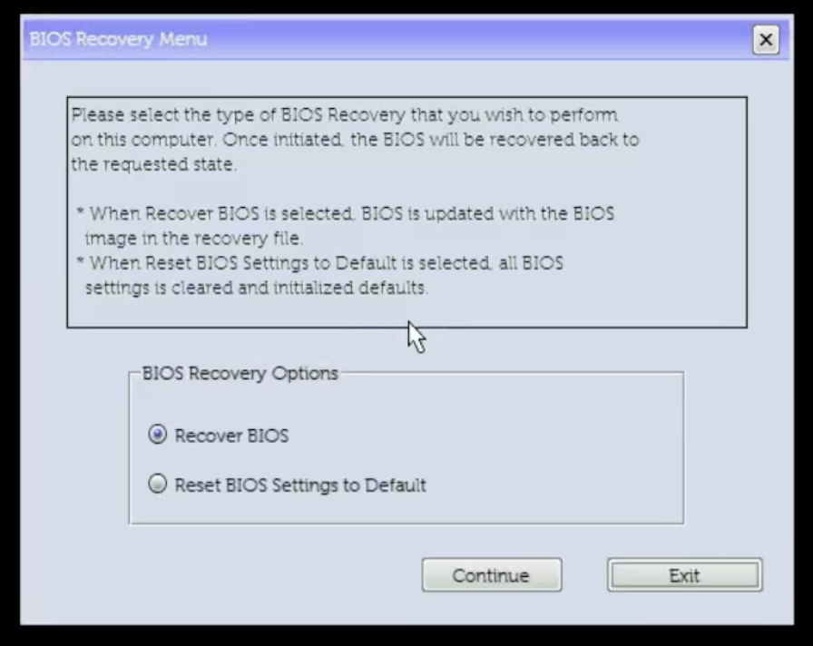

# Rollback and recovery

[简体中文](RECOVERY.zh-CN.md)

## Undo the customization

1. Normally shut down GPU VMs. Disable the resize service actually installed; for the supplied template:

   ```sh
   sudo systemctl disable --now rebar-resize.service
   ```

2. For Linux-only rollback, reboot normally with the service disabled and verify the firmware-default BAR. Stopping a oneshot service does not shrink a live BAR. A larger MMIO address window does not reserve the same amount of system RAM.
3. To undo the hidden setting, boot USB Shell **on the same reviewed BIOS** and run `REBAR-PLAN\ROLLBACK.nsh RUN` from the matching local plan. Require the complete original-variable comparison to pass before rebooting. If the current variable differs unexpectedly, stop and review it.

For BIOS **2.52.2 only**, the reference rollback is:

```text
setup_var.efi SocketCommonRcConfig:0x04(2)=0x0000
setup_var.efi SocketCommonRcConfig:0x04(2)
```

Use this only after confirming GUID, payload length, offset, width and recorded original value `0`. Preserve Base. Compare the entire payload; never bulk-import another machine's variable or an old blob after a BIOS update.

## BIOS upgrade or GPU move

Before upgrading, preserve backups and the official recovery image, record working storage/boot settings, stop VMs and disable resize automation. While still on the old reviewed BIOS, restore the custom granularity field and verify a baseline boot. Then follow [Dell's update instructions](https://www.dell.com/support/kbdoc/en-us/000124211/dell-bios-updates).

Resetting **all** BIOS settings is not required solely for this procedure; release-specific Dell instructions take precedence. After updating, check SATA mode, UEFI, VT-d and Above 4GB, then repeat the audit and exact-version IFR review. Generate new profiles/plans before re-enabling automation.

For a GPU move: disable automation, shut down, power off, move the card, then rediscover PCI topology/IOMMU/root space and review Proxmox PCI mappings. Replace the runtime profile. A valid global MMIO setting does not inherently require rollback merely because the slot changed.

## Choose the recovery path

| Failure | Action |
|---|---|
| PVE boots; resize fails | Leave GPU VMs stopped; inspect the service journal and disable automation |
| Shell works; hidden setting needs reversal | Use the matching verified field rollback |
| System boot loader unavailable | Try another existing EFI entry, then the tested USB PVE rescue path |
| One ESP is damaged | Verify its backup and exact target; restore only that ESP |
| No POST / F2 / F12 | Use the model-supported cold recovery entry; onsite assistance may be required |
| Recovery entry/reset fails | Board repair or external programming may be necessary |

### Restore one ESP only when needed

```sh
sudo python3 -B scripts/esp_backup.py verify --usb "$USB" \
  --manifest "$ESP_BACKUP_MANIFEST" --label "$ESP_LABEL"
```

This checks gzip/raw hashes, target PARTUUID, GPT ESP type, exact size and unmounted state. Deliberate restoration additionally requires `--restore --confirm-partuuid "$EXACT_ESP_PARTUUID"`. A lost boot entry alone does not justify overwriting an ESP. The helper does not repartition disks or restore VM data.

### Cold recovery entry

For a supported Precision 7920 Tower, shut down normally, leave a direct wired keyboard and recovery USB connected, disconnect AC for about 30 seconds, then hold Ctrl+Esc while reconnecting AC; release when the recovery menu appears. Follow [Dell's model-specific recovery instructions](https://www.dell.com/support/kbdoc/en-us/000132453/how-to-recover-the-bios-on-a-dell-computer-or-tablet).



During an entry test, select **Exit**. **Recover BIOS** writes firmware; **Reset BIOS Settings to Default** resets settings. Seeing the menu does not prove flashing will work or that this hidden variable will be cleared. CMOS clearing or reflashing may preserve UEFI variables. Without POST, SSH and ESP/variable backups alone cannot restore the machine; no universal recovery guarantee follows from having those backups.
