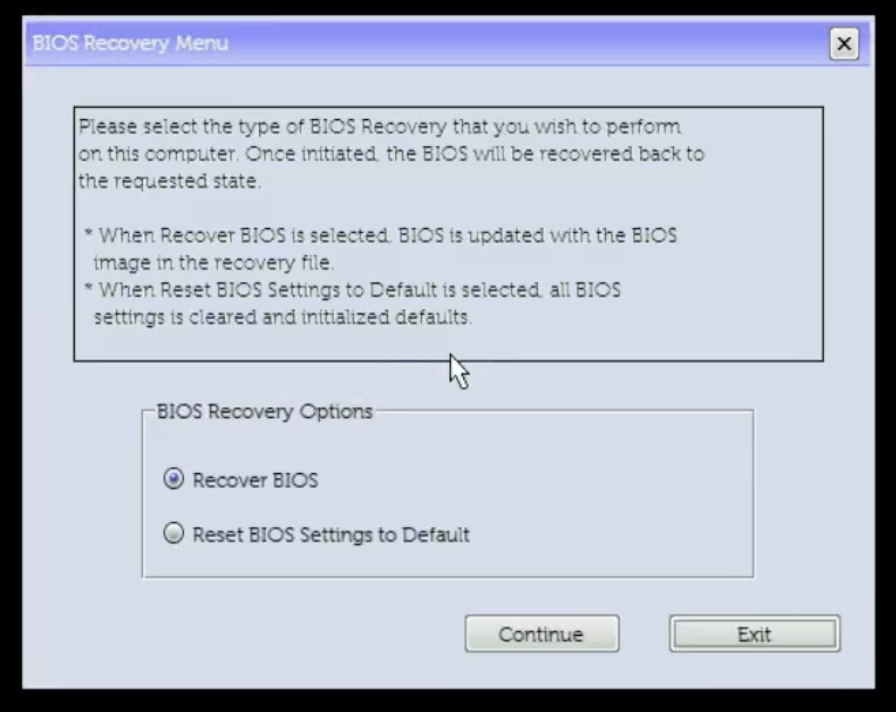

# 回滚与恢复

[English](RECOVERY.md)

## 撤销改动

1. 正常关闭GPU VM，停用实际安装的调整服务。使用仓库模板时：

   ```sh
   sudo systemctl disable --now rebar-resize.service
   ```

2. 只撤销Linux调整时，保持服务停用并正常重启，核实BAR回到固件默认大小。停止oneshot服务不会缩小当前BAR。扩大MMIO地址窗口不代表预留同等大小的系统RAM。
3. 撤销隐藏设置时，在**原已审核BIOS版本**下进入USB Shell，执行对应本机计划的`REBAR-PLAN\ROLLBACK.nsh RUN`。完整原变量比较通过后才能重启；当前变量有意外差异就停下复核。

> [!CAUTION]
> **仅限 BIOS 2.52.2。** 不要把这条 `0x04`/`0x0000` 回滚命令用到另一个 BIOS；使用前必须核实 GUID、偏移、宽度和记录的原值。优先使用生成的 `ROLLBACK.nsh`。

```text
setup_var.efi SocketCommonRcConfig:0x04(2)=0x0000
setup_var.efi SocketCommonRcConfig:0x04(2)
```

使用前必须核实GUID、payload长度、偏移、宽度及记录的原值`0`；生成的`ROLLBACK.nsh`会做完整变量比较。Base保持不变，比较完整payload。不能导入其他机器变量，也不能升级后整包恢复旧变量。

## 升级BIOS或移动GPU

升级前保留备份和官方恢复镜像，记录现有存储/引导设置，正常关闭VM并停用自动调整。仍在旧版已审核BIOS时恢复自定义Granularity字段，验证正常基线启动，再按[Dell升级说明](https://www.dell.com/support/kbdoc/en-us/000124211/dell-bios-updates)更新。

仅为本方案，不必把**全部**BIOS设置恢复默认；具体版本的Dell要求优先。升级后核对SATA模式、UEFI、VT-d和Above 4GB，再重新调查及审核准确版本IFR；生成新配置/计划后才恢复自动化。

移动GPU时：停用自动化，关机断电后换槽，重新发现PCI拓扑/IOMMU/根窗口并审核PVE PCI映射，替换运行配置。有效的全局MMIO设置不因换槽就必然需要回滚。

## 按故障选择恢复路径

| 故障 | 操作 |
|---|---|
| PVE能启动，但调整失败 | 保持GPU VM关闭，查服务日志，停用自动化 |
| Shell可用，需要撤销隐藏设置 | 使用匹配且已验证的字段回滚 |
| 系统引导器不可用 | 尝试其他现有EFI入口，再使用已实测的USB PVE救援 |
| 某个ESP损坏 | 核对备份和准确目标，仅恢复该ESP |
| 无法POST / F2 / F12 | 使用该机型支持的冷恢复入口，可能需要现场协助 |
| 恢复入口或重置也失败 | 可能需要主板维修或外置编程器 |

### 确有必要时才恢复单个ESP

```sh
sudo python3 -B scripts/esp_backup.py verify --usb "$USB" \
  --manifest "$ESP_BACKUP_MANIFEST" --label "$ESP_LABEL"
```

默认只检查gzip/原始哈希、目标PARTUUID、GPT ESP类型、准确大小和未挂载状态。实际恢复还需`--restore --confirm-partuuid "$EXACT_ESP_PARTUUID"`。仅启动项丢失不应覆盖ESP；此工具不会重新分区或恢复VM数据。

### 冷恢复入口

适用的Precision 7920 Tower：正常关机，保留直连有线键盘和恢复U盘，断开AC约30秒，按住Ctrl+Esc接回AC，出现菜单后松开。按[Dell机型相关恢复说明](https://www.dell.com/support/kbdoc/en-us/000132453/how-to-recover-the-bios-on-a-dell-computer-or-tablet)执行。



仅演练入口时选择**Exit**。**Recover BIOS**会写固件，**Reset BIOS Settings to Default**会重置设置。看到菜单不证明能刷写成功，也不证明隐藏变量会清除。清CMOS或重刷可能保留UEFI变量；无法POST时，SSH及ESP/变量备份本身不能恢复机器，不能据此保证所有故障都可恢复。
