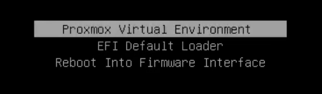

# Build, archive and replace a recovery USB

[简体中文](USB.zh-CN.md) · [Start](../README.md)

## What the USB does

- Boots an x86-64 UEFI Shell via `EFI/BOOT/BOOTX64.EFI`.
- Provides guarded variable checks/rollback and the exact official recovery image.
- Stores **this machine's** ESP/variable/config backups privately.
- For the documented systemd-boot/ZFS installation, starts the existing PVE root using copied loader/kernel/initrd even if system ESP files fail.

It does not replace VM/data backups or guarantee recovery from every no-POST failure. Firmware, ESP images, NVRAM dumps and boot entries from one machine must not be restored onto another.

> [!CAUTION]
> **Formatting and ESP restore are destructive.** Identify the USB by model/size/connection and confirm it has nothing you need; never select a system disk or your only backup. Verify every hash and readback.

## 1. Format a new USB — destructive, manual step

Use FAT32. An MBR/FAT32 removable drive or a GPT drive with a FAT32 EFI System Partition can expose the UEFI fallback path. Do not use exFAT/NTFS for the Shell/recovery volume. Windows' built-in formatter may limit FAT32 creation on larger volumes; use an appropriate verified FAT32 formatter instead of silently choosing exFAT.

**The following erase the selected whole USB. The placeholders are intentional; no repository script formats a disk.**

macOS example (single FAT32 removable partition):

```sh
diskutil list external physical
diskutil info /dev/diskN
diskutil eraseDisk MS-DOS REBAR MBRFormat /dev/diskN
diskutil info /Volumes/REBAR
```

Linux example (single GPT ESP):

```sh
lsblk -o NAME,SIZE,MODEL,TRAN,FSTYPE,UUID,PARTUUID,MOUNTPOINTS
sudo parted /dev/sdX --script mklabel gpt mkpart ESP fat32 1MiB 100% set 1 esp on
sudo mkfs.vfat -F 32 -n REBAR /dev/sdX1
sudo mkdir -p /mnt/rebar-usb
sudo mount -o rw,nosuid,nodev,noexec /dev/sdX1 /mnt/rebar-usb
```

The partition name changes on NVMe/other devices; do not derive it by blindly appending `1`. `noexec` affects Linux execution from the mount, not firmware booting the EFI file.

## 2. Populate and verify the tools

On Linux, set `USB` to the actual mount root. For a basic Shell USB:

```sh
USB=/mnt/rebar-usb
sudo python3 -B scripts/prepare_usb.py --usb "$USB"
```

The helper downloads pinned x64 Shell26H2 and setup_var0.3.1, checks SHA256, PE machine and EFI application type, and refuses existing contents. Shell's digest was publisher-provided; setup_var's pinned hash was locally observed, not an independent publisher signature. Review upstream provenance; pinning alone is not proof of trust.

For this systemd-boot/ZFS rescue path, identify the active ESP from boot information, mount it **read-only** at a separate directory, and select the actual current loader entry. On a fresh USB, use the combined invocation instead of the basic invocation:

```sh
sudo mount -o ro,nosuid,nodev,noexec "$ESP_DEVICE" /mnt/esp-ro
sudo python3 -B scripts/prepare_usb.py --usb "$USB" \
  --esp-readonly-mount /mnt/esp-ro --entry "$CURRENT_LOADER_ENTRY"
sudo umount /mnt/esp-ro
```

`--entry` is the filename under `<ESP>/loader/entries/` (for example `--entry proxmox.conf`), not a path. The helper needs `findmnt` and `lsinitramfs` (initramfs-tools). It copies the current systemd-boot loader, loader entry and referenced kernel/initrd, checks every copy, and requires ZFS support in the initrd. It never changes the system ESP or BootOrder. For GRUB, encryption, other root filesystems or different boot layouts, design and actually test the corresponding rescue path rather than using this helper unchanged. A rescue USB must be refreshed when the required kernel/root/module compatibility changes.

Download Dell's exact model/version recovery image, verify its official checksum, then append `--bios-image "$OFFICIAL_EXE" --bios-sha256 "$OFFICIAL_SHA256"` to that same initial invocation if its recovery procedure permits EXE→`BIOS_IMG.rcv` renaming. For the 2.52.2 release: [Dell driver41C9J](https://www.dell.com/support/home/en-us/drivers/driversdetails?driverid=41c9j), SHA256 `0328056ac3573456ac3431e00d4e545c06d485bd87e4a17875ca82412001ac50`. This recipe must be checked again for another release/model. Do not use an extracted research BIOS region as this file.

## 3. Make private backups directly on USB

```sh
sudo python3 -B scripts/esp_backup.py create --usb "$USB" \
  --esp-partuuid "$ESP_A_PARTUUID" --esp-partuuid "$ESP_B_PARTUUID"
```

The helper reads explicitly selected unmounted GPT ESP partitions, writes gzip images and a private manifest, reopens/decompresses each image and verifies raw SHA256, and saves the live variable. It refuses overwriting prior backups. Size/free-space/device-type checks are mandatory. Also record working SATA mode, UEFI/VT-d/Above4GB settings and the relevant boot configuration; keep any configuration export containing credentials offline. Back up the required PVE/boot configuration separately; ESP backups do not include ZFS/VM data.

For offline recovery rehearsal, decompress each ESP image into an ordinary **USB file**, verify raw SHA256 and run `fsck.fat -n` on that file; optionally mount it read-only using a loop device and compare loader/kernel/initrd hashes. This does not overwrite a live ESP. Never add `-a` or run repairing fsck against the system ESP for a rehearsal.

Generate the guarded firmware plan only after [firmware review](FIRMWARE.md). Do not copy an old machine's expected-variable files or delete existing round-trip evidence to make a script run again.

## 4. Actually boot it

1. Normally stop VMs, reboot, press F12 and select the **UEFI** USB entry. If missing, check FAT32, the fallback file path and whether firmware USB boot/ports are enabled. Those USB options concern recovery access, not BAR size.
2. In Shell, `map -r`, then inspect `fs0:`, `fs1:` etc with `ls` until you find this USB. Never assume a fixed FS number. Run the plan's CHECK only and save the current variable.
3. Run `PVE-RESCUE.nsh`. Confirm original PVE/ZFS/network returns, the boot loader device corresponds to this USB, and no system restoration was performed.



Before the later write session, separately verify the machine's cold-start recovery-menu entry as described in [Recovery](RECOVERY.md), without selecting Continue. Merely reaching that menu does not test a flash.

## 5. Package a replacement-ready recovery USB

This is a **functional recovery package**, not an archive of screenshots, tutorials, research downloads or historical test-image copies. Store documentation and evidence according to the [data policy](PRIVACY.md). Include the boot layout, required tools, actual original recovery backups, local safety configuration and a short offline recovery card.

With a reviewed `REBAR-PLAN` already on USB, copy the Python tools and include every plan file at its original path:

```sh
mkdir -p "$USB/RECOVERY/scripts"
cp scripts/rebar_audit.py scripts/rebar_resize.py scripts/ifr_review.py \
  scripts/make_profile.py scripts/uefi_plan.py scripts/esp_backup.py \
  scripts/usb_archive.py scripts/recovery_manifest.py "$USB/RECOVERY/scripts/"
set --
for plan_file in "$USB"/REBAR-PLAN/*; do
  set -- "$@" --extra "${plan_file#"$USB"/}"
done
python3 -B scripts/recovery_manifest.py --usb "$USB" --backup-dir REBAR-BACKUP \
  --extra USB-PROVENANCE.json "$@"
python3 -B scripts/usb_archive.py create --usb "$USB" \
  --include-list "$USB/RECOVERY-INCLUDE.json" \
  --output "$USB/ARCHIVES/recovery-usb" --single-zip
```

For an existing case, specify its actual original backup directory instead of REBAR-BACKUP and explicitly add required extra plan/service files with `--extra`. Inspect RECOVERY-INCLUDE.json before packaging. It selects EFI/loader files, tools, guarded root Shell scripts, the RECOVERY folder and actual backup directory. Screenshots, Git trees and restore-drill images are rejected. Do not package the entire USB merely because those extra files happen to be present.

Use one **recovery-usb.zip** if the payload fits FAT32's 4GiB file limit; otherwise omit `--single-zip` for ≤2GiB parts. Existing gzip ESP images are stored without pointless recompression. The output directory has parts.json for size/SHA256 and VERIFIED.json only after every ZIP CRC and archived-file SHA256 passes. Its ARCHIVE-MANIFEST.json records the exact functional file tree. The ARCHIVES container is never recursively included.

Place usb_archive.py and rebar_audit.py beside the ZIP/checksum files for restoration without another download. Store short English/Chinese format/restore/F12 instructions there. Full tutorials and original screenshots stay in your private repository; only reviewed/anonymized screenshots go in the public repo. The ZIP contains private backups/configuration and is not encrypted: restrict NAS access.

## 6. Rebuild a new USB from the NAS copy

Copy the ZIP, parts.json, VERIFIED.json and the two restore-helper Python files to the NAS as one folder. For multipart mode, copy every part too. Format a new FAT32 USB as in step 1; keep the archive on NAS rather than the destination USB.

```sh
python3 -B usb_archive.py verify "$NAS_ARCHIVE_DIR"
python3 -B usb_archive.py extract "$NAS_ARCHIVE_DIR" \
  --usb "$NEW_USB" --confirm-target-uuid "$NEW_VOLUME_UUID"
```

Get the new volume UUID from findmnt on Linux or diskutil info on macOS. The helper requires a mounted FAT32 target, exact UUID confirmation and empty contents apart from OS metadata; it refuses to overwrite, extracts the same boot/recovery layout, and rereads each restored file to verify its hash. It needs no large temporary file on the Mac. MIGRATION.json records the expected new volume identity.

The new USB UUID/PARTUUID will differ. Do not change original system-ESP identifiers in backup manifests to bypass target matching. Use RECOVERY/scripts/esp_backup.py with the original manifest and new USB path; the current generic helper still matches the original system ESP PARTUUID/type/size/hash. Historical fixed-USB-UUID tools may correctly refuse the new drive. Use system backups only on the machine they were created for.

Check EFI/BOOT/BOOTX64.EFI, then actually perform F12→UEFI USB→Shell and PVE-RESCUE.nsh. File extraction success is not a physical boot test. After a BIOS change, re-audit and regenerate firmware plans; do not execute an old plan merely because it survived the USB restore. The original backups remain available for deliberate single-ESP or precise variable recovery using the documented checks.
