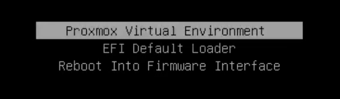

# 制作、归档与更换恢复U盘

[English](USB.md) · [入口](../README.zh-CN.md)

## U盘的作用

- 通过`EFI/BOOT/BOOTX64.EFI`启动x64 UEFI Shell。
- 提供有保护的变量核验/回滚和准确的官方恢复镜像。
- 私密保存**本机**的ESP/变量/配置备份。
- 对本文systemd-boot/ZFS安装，使用复制的引导器/内核/initrd启动原PVE根系统，即使系统ESP文件失效也有备用入口。

它不能替代VM/数据备份，也不保证所有无法POST的情况可恢复。不能把一台机器的固件、ESP、NVRAM或启动项恢复到另一台机器。

## 1. 格式化新U盘：手动破坏性步骤

使用FAT32。MBR/FAT32可移动盘，或GPT上的FAT32 EFI System Partition，都可放置UEFI回退路径。不要选exFAT/NTFS。Windows内置格式化工具可能限制大容量FAT32，需选择经过核实的FAT32工具，不要悄悄改用exFAT。

**以下命令会清空选中的整个U盘。必须按型号、容量、连接方式确认目标且无需要保留的数据；不能选系统盘或现有备份U盘。示例故意使用占位符。仓库脚本不会格式化磁盘。**

macOS示例（单FAT32可移动分区）：

```sh
diskutil list external physical
diskutil info /dev/diskN
diskutil eraseDisk MS-DOS REBAR MBRFormat /dev/diskN
diskutil info /Volumes/REBAR
```

Linux示例（单GPT ESP）：

```sh
lsblk -o NAME,SIZE,MODEL,TRAN,FSTYPE,UUID,PARTUUID,MOUNTPOINTS
sudo parted /dev/sdX --script mklabel gpt mkpart ESP fat32 1MiB 100% set 1 esp on
sudo mkfs.vfat -F 32 -n REBAR /dev/sdX1
sudo mkdir -p /mnt/rebar-usb
sudo mount -o rw,nosuid,nodev,noexec /dev/sdX1 /mnt/rebar-usb
```

NVMe等设备分区命名不同，不能机械地在设备名后加1。`noexec`只限制Linux从挂载点执行，不妨碍固件启动EFI文件。

## 2. 填充和校验工具

Linux中把`USB`指向实际挂载根目录。基本Shell U盘：

```sh
USB=/mnt/rebar-usb
sudo python3 -B scripts/prepare_usb.py --usb "$USB"
```

脚本下载固定x64 Shell26H2与setup_var0.3.1，核对SHA256、PE架构和EFI应用类型，拒绝覆盖已有内容。Shell哈希由发行方提供；setup_var固定哈希为本地核算值，不是独立的发行方签名。固定哈希不能替代来源审核。

对于本文systemd-boot/ZFS救援，先从引导信息识别当前ESP，单独**只读**挂载，并选择实际当前loader entry。新U盘要使用下列合并调用，不要先跑上面的基本调用：

```sh
sudo mount -o ro,nosuid,nodev,noexec "$ESP_DEVICE" /mnt/esp-ro
sudo python3 -B scripts/prepare_usb.py --usb "$USB" \
  --esp-readonly-mount /mnt/esp-ro --entry "$CURRENT_LOADER_ENTRY"
sudo umount /mnt/esp-ro
```

它复制当前systemd-boot、loader entry及引用的内核/initrd，逐文件校验并确认initrd含ZFS支持，不改变系统ESP或BootOrder。GRUB、加密、其他根文件系统或不同引导布局，必须另外设计并实测救援路径；内核/根系统/模块兼容关系变化时要更新救援U盘。

从Dell下载准确机型/版本的恢复镜像，核对官方哈希；如果该机型恢复流程允许EXE直接改名`BIOS_IMG.rcv`，可在同一次初始调用加入`--bios-image "$OFFICIAL_EXE" --bios-sha256 "$OFFICIAL_SHA256"`。2.52.2参考来源为[Dell driver41C9J](https://www.dell.com/support/home/en-us/drivers/driversdetails?driverid=41c9j)，SHA256 `0328056ac3573456ac3431e00d4e545c06d485bd87e4a17875ca82412001ac50`。换机型/版本需重新核对；不能用提取的研究BIOS区域替代恢复文件。

## 3. 直接备份到U盘

```sh
sudo python3 -B scripts/esp_backup.py create --usb "$USB" \
  --esp-partuuid "$ESP_A_PARTUUID" --esp-partuuid "$ESP_B_PARTUUID"
```

脚本读取明确指定且未挂载的GPT ESP，写gzip镜像和私有清单，重新打开并解压逐份验证原始SHA256，同时保存实机变量；拒绝覆盖原备份。容量、剩余空间和设备类型检查不能跳过。另记录可工作的SATA、UEFI、VT-d、Above4GB和引导配置；含凭据的配置导出只离线保存。另行备份所需PVE/引导配置；ESP备份不含ZFS/VM数据。

离线恢复演练：把每份ESP镜像解压到**USB普通文件**，核对原始SHA256并对该文件执行`fsck.fat -n`；可进一步只读loop挂载，比较引导器/内核/initrd哈希。不会覆盖真实ESP。演练不能加`-a`，也不能对系统ESP运行修复式fsck。

完成[固件审核](FIRMWARE.zh-CN.md)后才生成有保护的Shell计划。不能复制另一台机器的预期变量文件，也不能删除旧往返证据来强行重跑。

## 4. 真正启动验证

1. 正常关VM，重启按F12，选择U盘的**UEFI**入口。找不到时检查FAT32、回退文件路径及USB启动/端口是否开启。这些USB选项影响救援入口，不影响BAR大小。
2. Shell执行`map -r`，依次检查`fs0:`、`fs1:`等并用`ls`找U盘，不能假定固定FS号。只运行计划中的CHECK并保存变量。
3. 运行`PVE-RESCUE.nsh`；确认原PVE/ZFS/网络恢复、引导器设备来自该U盘，且未执行系统恢复写入。



后续正式写入前，另外按[恢复说明](RECOVERY.zh-CN.md)验证冷启动恢复菜单入口，不能选Continue。能看到菜单不等于测试过刷写。

## 5. 打包可重建的恢复U盘

这是**功能性恢复包**，不是截图、完整教程、研究下载或历史测试镜像的归档；教程和证据按[资料规则](PRIVACY.zh-CN.md)保存。包内保留启动布局、必要工具、真正的原始恢复备份、本机安全配置和简短离线恢复卡。

先确保U盘已有审核后的`REBAR-PLAN`；复制Python工具，并按原路径加入全部计划文件：

```sh
mkdir -p "$USB/RECOVERY/scripts"
cp scripts/rebar_audit.py scripts/rebar_resize.py scripts/ifr_review.py \
  scripts/make_profile.py scripts/uefi_plan.py scripts/esp_backup.py \
  scripts/usb_archive.py scripts/recovery_manifest.py "$USB/RECOVERY/scripts/"
set --
for plan_file in "$USB"/REBAR-PLAN/*; do
  set -- "$@" --extra "${plan_file#"$USB"/}"
done
python3 -B scripts/recovery_manifest.py --usb "$USB" --backup-dir REBAR-BACKUP \
  --extra USB-PROVENANCE.json "$@"
python3 -B scripts/usb_archive.py create --usb "$USB" \
  --include-list "$USB/RECOVERY-INCLUDE.json" \
  --output "$USB/ARCHIVES/recovery-usb" --single-zip
```

已有案例应把REBAR-BACKUP换成真实原备份目录，额外必需的计划/服务文件用--extra明确加入。打包前检查RECOVERY-INCLUDE.json：只选择EFI/loader、工具、有保护的根目录Shell脚本、RECOVERY目录和原备份目录；拒绝截图、Git目录和restore-drill测试镜像。不能因U盘里碰巧有其他资料就整盘归档。

内容小于FAT32单文件4GiB上限时，使用普通**recovery-usb.zip**；过大则去掉`--single-zip`，改用不超过2GiB分卷。现有ESP gzip镜像不再无谓压缩。输出parts.json记录大小/SHA256，只有所有ZIP CRC和归档文件SHA256通过才生成VERIFIED.json；包内ARCHIVE-MANIFEST.json记录准确功能文件树。不会递归包含ARCHIVES目录。

把usb_archive.py和rebar_audit.py也放在ZIP/校验文件旁边，使还原不必另下载工具；旁边提供中英简短格式化/还原/F12步骤。完整教程和原图留Git。ZIP含私有备份/配置且不加密，NAS应限制访问。

## 6. 用NAS副本重建新U盘

把ZIP、parts.json、VERIFIED.json及两个恢复助手Python文件一起保存到NAS；若使用分卷，全部卷都要保留。按步骤1格式化新FAT32 U盘，归档留NAS，不放到待还原U盘上。

```sh
python3 -B usb_archive.py verify "$NAS_ARCHIVE_DIR"
python3 -B usb_archive.py extract "$NAS_ARCHIVE_DIR" \
  --usb "$NEW_USB" --confirm-target-uuid "$NEW_VOLUME_UUID"
```

Linux用findmnt、macOS用diskutil info取得新卷UUID。脚本要求已挂载FAT32、准确UUID确认、除系统元数据外为空；拒绝覆盖，恢复同样的启动/备份布局，再逐文件读回校验，不在Mac产生大临时文件。MIGRATION.json记录新卷身份。

新U盘UUID/PARTUUID改变属于正常现象，不能篡改原备份里的系统ESP标识绕过匹配。用RECOVERY/scripts/esp_backup.py、原清单和新USB路径；通用工具仍按原系统ESP的PARTUUID/类型/大小/哈希匹配。历史固定USB UUID工具会正确拒绝新盘。系统备份仅用于生成备份的原机器。

检查EFI/BOOT/BOOTX64.EFI，再实际执行F12→UEFI U盘→Shell及PVE-RESCUE.nsh。文件提取成功不等于已实测新U盘启动。升级BIOS后重新审核并生成计划，不能因旧脚本被还原出来就直接写入。原始备份仍可按防误写检查用于单ESP或精确变量恢复。
